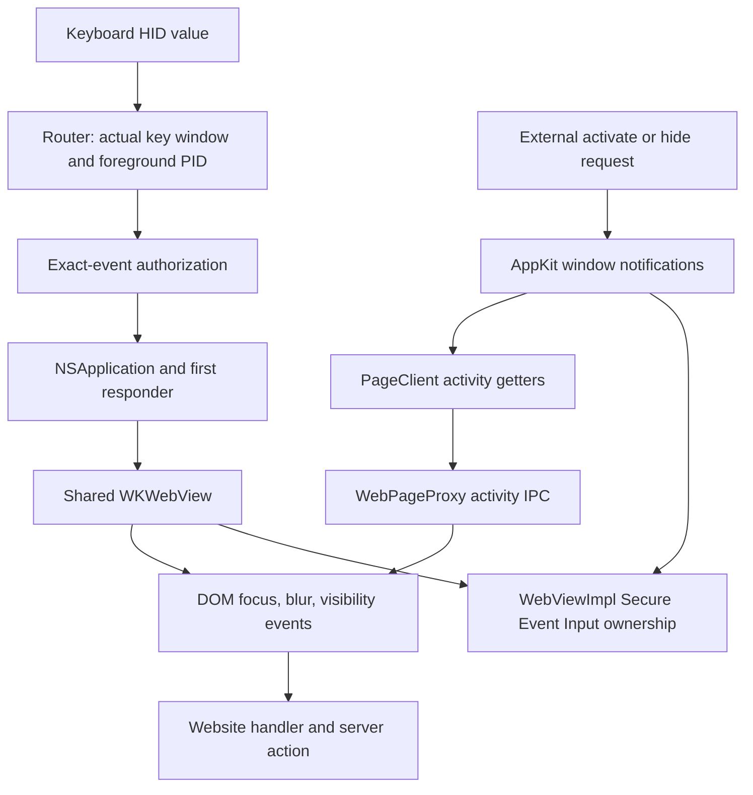

# How keyboard input and page activity reach the same web view

Grounding review: October 26, 2026. This explains the current source and diagnostic receipts. It does not establish security across arbitrary websites.

The browser has two independent paths into web content. The keyboard path authorizes individual events. The native activity path tells WebKit about window focus and visibility. Ordinary website code can act on either path. Secure Event Input adds a third concern: native ownership that must follow actual input eligibility.

The source trace below uses WebKit revision [`94f9b7905e3ce9a3d7497f26b563adcad6b7525f`](https://github.com/WebKit/WebKit/commit/94f9b7905e3ce9a3d7497f26b563adcad6b7525f). This upstream revision does not identify the installed macOS framework. Local receipts establish the measured framework behavior separately.

## State and ownership

| State or component | Meaning and owner |
| --- | --- |
| `DeviceKeyboardRouter` | Reads keyboard HID values, checks actual input eligibility, binds a measured device, and constructs local key events. |
| `DeviceEventGate.pending` | Retains authorized `NSEvent` objects by `ObjectIdentifier`. Each authorization can be consumed once. |
| AppKit first responder | Determines whether accepted keys reach the address field or the shared `WKWebView`. |
| WebKit `ActivityState` | A bit set containing page focus, active-window, visibility, and in-window state. This is independent of event authorization. |
| WebKit `m_inSecureInputState` | Tracks WebKit's own Secure Event Input ownership. It is distinct from the browser controller's ownership flag. |
| Actual versus logical window state | Actual state describes AppKit's window. The stable-activity diagnostic returns fixed values to callers of selected window getters. |

## Physical keyboard route

In [DeviceKeyboard.swift](../../Sources/Browser/DeviceKeyboard.swift), `DeviceKeyboardRouter.start()` opens a nonseizing `IOHIDManager`. It registers keyboard callbacks on the main run loop. `receive(_:)` first requires the window to be key and the actual foreground application's PID to equal `getpid()`.

The first device Space can bind a source accepted by [HIDSourcePolicy.swift](../../Sources/Browser/HIDSourcePolicy.swift). The policy checks measured registry ancestry and rejects known software sources. This research bootstrap is not proof of a human. Subsequent values must come from that bound device. The router tracks pressed usages, handles modifiers, and maps supported US ASCII and navigation keys.

The router constructs an `NSEvent` and calls `DeviceKeyboardApplication.dispatchDeviceEvent(_:)`. That method authorizes the exact object, then calls `sendEvent(_:)`. The application consumes the authorization before passing the event to `super.sendEvent`. An independently posted key event lacks that object authorization. Command-L instead invokes the browser's location callback after authorization.

[BrowserApp.swift](../../Sources/Browser/BrowserApp.swift) owns one window, address field, and web view. Return in the address field calls `navigate()`, validates the URL, loads the web view, and makes it first responder. Tab, text, and Return then use the same event route to reach website controls. This is shared content, rather than a second renderer for authorized input.

The diagnostic deliberately supplies its own authorized events. In `.build/InternalKeyboardControl.swift`, the router is constructed but never started. Its private sequence calls `dispatchDeviceEvent` directly. Therefore `humanBaseline=false` and successful private resume demonstrate internal routing, not physical keyboard usability.

## External activation and hide route

[ResearchFocus.swift](../../Sources/Diagnostics/ResearchFocus.swift) calls `NSRunningApplication.activate`, `hide`, or `unhide` for an allowed research app. It sends no keyboard events or Accessibility actions. Once armed, the [fixture](../../tools/feature-fixture.html) can submit another server action from a normal focus, blur, or visibility listener.

In the pinned WebKit source, `WKWindowVisibilityObserver` observes key-window, ordering, minimization, and occlusion notifications. It calls `WebViewImpl` handlers. Key changes request `WindowIsActive` updates; ordering and visibility handlers request the corresponding activity updates. These callbacks do not need an accepted keyboard or mouse event. [WebViewImpl.mm](https://github.com/WebKit/WebKit/blob/94f9b7905e3ce9a3d7497f26b563adcad6b7525f/Source/WebKit/UIProcess/mac/WebViewImpl.mm#L2412).

`WebPageProxy::updateActivityState()` samples `PageClientImpl`. Its active-window getter accepts `window.isKeyWindow` or identity with `NSApp.keyWindow`. View focus compares the window's first responder with the web view, apart from responder-transition flags. Visibility checks the window, hidden view ancestors, window visibility, and normally occlusion. `isViewVisibleOrOccluded()` reads window visibility; `isViewInWindow()` checks window existence. These getters contain no separate `NSApp.isActive` or `NSApp.isHidden` condition. [PageClientImplMac.mm](https://github.com/WebKit/WebKit/blob/94f9b7905e3ce9a3d7497f26b563adcad6b7525f/Source/WebKit/UIProcess/mac/PageClientImplMac.mm#L165).

`WebPageProxy::dispatchActivityStateChange()` sends `SetActivityState` IPC. The web process calls `WebPage::setActivityState()`, which forwards changes to WebCore `Page::setActivityState()`. [WebPageProxy.cpp](https://github.com/WebKit/WebKit/blob/94f9b7905e3ce9a3d7497f26b563adcad6b7525f/Source/WebKit/UIProcess/WebPageProxy.cpp#L3556), [WebPage.cpp](https://github.com/WebKit/WebKit/blob/94f9b7905e3ce9a3d7497f26b563adcad6b7525f/Source/WebKit/WebProcess/WebPage/WebPage.cpp#L4827).

`FocusController::setActivityState()` compares combined page focus and active-window state. A change dispatches window and focused-element events. Visibility changes reach `Document::visibilityStateChanged()`, which queues `visibilitychange`. Its `TaskSource::UserInteraction` name describes a task queue, not authenticated physical input. Website listeners can then call `fetch` without passing through `DeviceEventGate`. [FocusController.cpp](https://github.com/WebKit/WebKit/blob/94f9b7905e3ce9a3d7497f26b563adcad6b7525f/Source/WebCore/page/FocusController.cpp#L1239), [Page.cpp](https://github.com/WebKit/WebKit/blob/94f9b7905e3ce9a3d7497f26b563adcad6b7525f/Source/WebCore/page/Page.cpp#L3535), [Document.cpp](https://github.com/WebKit/WebKit/blob/94f9b7905e3ce9a3d7497f26b563adcad6b7525f/Source/WebCore/dom/Document.cpp#L2602).

## Actual versus logical state in the diagnostic

The `--stable-activity` host uses `.build/InternalFocusBoundary.swift`. Its window returns constant `true` for `isKeyWindow` and `isVisible`, plus `.visible` for `occlusionState`. AppKit still processes actual window transitions. The host logs those through `super.isKeyWindow` and `super.isVisible`.

The diagnostic router in `.build/InternalFocusDeviceKeyboard.swift` independently requires both:

- `diagnosticActualKeyWindow == true`, where that property returns `super.isKeyWindow`.
- `NSWorkspace.shared.frontmostApplication?.processIdentifier == getpid()`.

These are the actual input guards that the next architecture must preserve. A fixed logical getter must not become authority for hardware routing. Neither predicate alone expresses both actual window eligibility and actual foreground ownership.

The [visibility](../../artifacts/activity-stable-visibility/results.json) and [blur](../../artifacts/activity-stable-blur/results.json) receipts each record no new external action. Each private resume then records one action. These are single diagnostic trials, with `humanBaseline=false`.

## Secure Event Input follows a separate path

WebKit's `WebViewImpl::updateSecureInputState()` checks its window's key getter and view focus. If either fails, it releases tracked ownership. Otherwise, password editor state can enable ownership. Key/resign-key notifications and editor-state changes call this logic. Fixed logical key state therefore affects this native protection as well as page activity. [WebViewImpl.mm](https://github.com/WebKit/WebKit/blob/94f9b7905e3ce9a3d7497f26b563adcad6b7525f/Source/WebKit/UIProcess/mac/WebViewImpl.mm#L2965), [WebPageProxyMac.mm](https://github.com/WebKit/WebKit/blob/94f9b7905e3ce9a3d7497f26b563adcad6b7525f/Source/WebKit/UIProcess/mac/WebPageProxyMac.mm#L795).

`resetSecureInputState()` releases WebKit's own tracked ownership without changing DOM focus. Resigning first responder, closing the window, and WKWebView destruction use this reset. The macOS private selector `-_resetSecureInputState` exposes that reset internally. This source fact does not establish a supported release-and-rearm policy. [WKWebViewMac.mm](https://github.com/WebKit/WebKit/blob/94f9b7905e3ce9a3d7497f26b563adcad6b7525f/Source/WebKit/UIProcess/API/mac/WKWebViewMac.mm#L1589), [WKWebView.mm](https://github.com/WebKit/WebKit/blob/94f9b7905e3ce9a3d7497f26b563adcad6b7525f/Source/WebKit/UIProcess/API/Cocoa/WKWebView.mm#L954).

`BrowserController.releaseSecureInput()` balances only the controller's `ownsSecureInput` flag. That flag belongs to separate experiment configurations. It does not represent WebKit's password-field ownership.

The [password receipt](../../artifacts/activity-stable-password/results.json) records `actualKey=false` and `actualVisible=false` during hide, while both logical getters remain true. It records `secureInputWhileAway=true`, zero external actions, and one private resume action. The logged foreground PID remains the candidate PID at that transition; this receipt does not demonstrate another app becoming foreground.

`IsSecureEventInputEnabled()` measures aggregate system state, rather than directly reading WebKit's ownership flag. Retained WebKit ownership is consistent with the source path and observed contrast with the readable control. It remains an inference. Cleanup succeeded: `candidateCleanupVerified=true`, `sinkCleanupVerified=true`, and `secureInputAfterCleanup=false`.

This exposes the current boundary: logical page activity stayed stable in these trials, while native password protection did not release during hide. Private resume success does not prove correct protection before physical password entry. Neither result establishes an agent-free browser.
